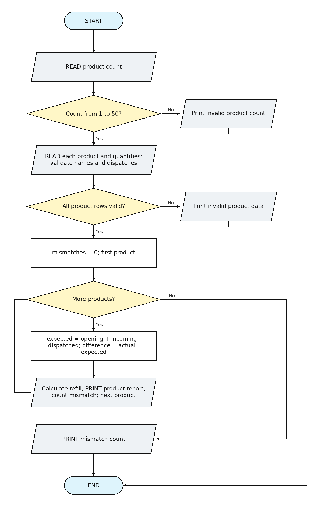
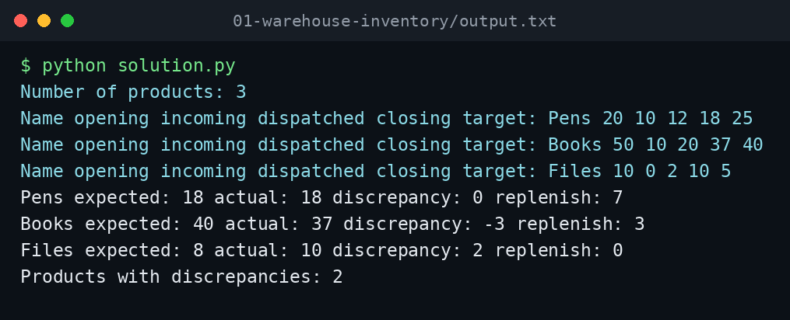

# Case 14: Warehouse Inventory Reconciliation

## Problem statement

Compare opening stock, receipts, dispatches and actual closing stock for several products. Report discrepancies and replenishment needs.

## Objectives

Use lists and tuples to reconcile stock and calculate shortages.

## Assumptions

Quantities are whole nonnegative units. Product names are unique single words. There are 1 to 50 products. Dispatch cannot exceed opening stock plus receipts. Discrepancy = actual closing - expected closing; replenishment uses actual closing stock and the target.

## Algorithm

1. Read and validate the product count.
2. Read each product and five quantities; reject duplicate names and impossible dispatches.
3. If all rows are valid, calculate expected closing, discrepancy and replenishment.
4. Print each result and the number of mismatched products.

## Flowchart



## Pseudocode

```text
READ count and product rows
IF any input is invalid THEN PRINT error
ELSE
  FOR each product tuple
    expected = opening + incoming - dispatched
    discrepancy = closing - expected
    replenishment = maximum of zero and target - closing
    PRINT result; count nonzero discrepancies
  PRINT mismatch count
END IF
```

## Python source code

`solution.py`

```python
# Case 14: Warehouse Inventory Reconciliation
text = input('Number of products: ').strip()
if not text.isascii() or not text.isdigit() or not 1 <= int(text) <= 50:
    print('Invalid product count')
else:
    products = []
    names = []
    valid = True
    for i in range(int(text)):
        row = input('Name opening incoming dispatched closing target: ').split()
        row_ok = len(row) == 6
        if row_ok:
            for value in row[1:]:
                if not value.isascii() or not value.isdigit():
                    row_ok = False
        if row_ok:
            name = row[0]
            opening, incoming = int(row[1]), int(row[2])
            dispatched, closing, target = int(row[3]), int(row[4]), int(row[5])
            if name in names or dispatched > opening + incoming:
                row_ok = False
        if not row_ok:
            valid = False
        else:
            names.append(name)
            products.append((name, opening, incoming, dispatched, closing, target))
    if not valid:
        print('Invalid product data')
    else:
        mismatches = 0
        for name, opening, incoming, dispatched, closing, target in products:
            expected = opening + incoming - dispatched
            difference = closing - expected
            refill = max(0, target - closing)
            if difference != 0:
                mismatches += 1
            print(name, 'expected:', expected, 'actual:', closing,
                  'discrepancy:', difference, 'replenish:', refill)
        print('Products with discrepancies:', mismatches)
```

`demo_input.txt` (one line per prompt):

```text
3
Pens 20 10 12 18 25
Books 50 10 20 37 40
Files 10 0 2 10 5
```

## Test cases

1. **reconciliation**

Input:
```text
3
Pens 20 10 12 18 25
Books 50 10 20 37 40
Files 10 0 2 10 5
```
Expected output includes:
```text
Pens expected: 18 actual: 18 discrepancy: 0 replenish: 7
Books expected: 40 actual: 37 discrepancy: -3 replenish: 3
Files expected: 8 actual: 10 discrepancy: 2 replenish: 0
Products with discrepancies: 2
```

2. **zero stock**

Input:
```text
1
A 0 0 0 0 0
```
Expected output includes:
```text
A expected: 0 actual: 0 discrepancy: 0 replenish: 0
```

3. **dispatch all stock**

Input:
```text
1
A 5 2 7 0 4
```
Expected output includes:
```text
expected: 0 actual: 0 discrepancy: 0 replenish: 4
```

4. **impossible dispatch**

Input:
```text
1
A 5 2 8 0 4
```
Expected output includes:
```text
Invalid product data
```

5. **negative quantity**

Input:
```text
1
A -1 2 0 1 4
```
Expected output includes:
```text
Invalid product data
```

6. **duplicate product**

Input:
```text
2
A 1 0 0 1 1
A 1 0 0 1 1
```
Expected output includes:
```text
Invalid product data
```

7. **missing field**

Input:
```text
1
A 1 2
```
Expected output includes:
```text
Invalid product data
```

8. **invalid count**

Input:
```text
0
```
Expected output includes:
```text
Invalid product count
```

Run `python test_cases.py` from this folder, or use the root test runner.

`test_cases.py`

```python
# Standard-library checks; run with Python 3.
from pathlib import Path
import subprocess
import sys

solution = Path(__file__).with_name('solution.py')
tests = [('reconciliation',
  '3\nPens 20 10 12 18 25\nBooks 50 10 20 37 40\nFiles 10 0 2 10 5\n',
  ['Pens expected: 18 actual: 18 discrepancy: 0 replenish: 7',
   'Books expected: 40 actual: 37 discrepancy: -3 replenish: 3',
   'Files expected: 8 actual: 10 discrepancy: 2 replenish: 0',
   'Products with discrepancies: 2']),
 ('zero stock',
  '1\nA 0 0 0 0 0\n',
  ['A expected: 0 actual: 0 discrepancy: 0 replenish: 0']),
 ('dispatch all stock',
  '1\nA 5 2 7 0 4\n',
  ['expected: 0 actual: 0 discrepancy: 0 replenish: 4']),
 ('impossible dispatch', '1\nA 5 2 8 0 4\n', ['Invalid product data']),
 ('negative quantity', '1\nA -1 2 0 1 4\n', ['Invalid product data']),
 ('duplicate product',
  '2\nA 1 0 0 1 1\nA 1 0 0 1 1\n',
  ['Invalid product data']),
 ('missing field', '1\nA 1 2\n', ['Invalid product data']),
 ('invalid count', '0\n', ['Invalid product count'])]

for name, data, expected in tests:
    result = subprocess.run(
        [sys.executable, str(solution)], input=data,
        text=True, capture_output=True, timeout=5)
    if result.returncode != 0:
        raise AssertionError(name + ': program crashed\n' + result.stderr)
    for line in expected:
        if line not in result.stdout:
            raise AssertionError(name + ': missing ' + repr(line)
                                 + '\nActual output:\n' + result.stdout)
    print('PASS:', name)
print(str(len(tests)) + ' tests passed')
```

`test_results.txt`

```text
PASS: reconciliation
PASS: zero stock
PASS: dispatch all stock
PASS: impossible dispatch
PASS: negative quantity
PASS: duplicate product
PASS: missing field
PASS: invalid count
8 tests passed
```

## Output screenshots



Terminal-style image rendered from the real interactive session in `output.txt` (including entered sample input):

```text
Number of products: 3
Name opening incoming dispatched closing target: Pens 20 10 12 18 25
Name opening incoming dispatched closing target: Books 50 10 20 37 40
Name opening incoming dispatched closing target: Files 10 0 2 10 5
Pens expected: 18 actual: 18 discrepancy: 0 replenish: 7
Books expected: 40 actual: 37 discrepancy: -3 replenish: 3
Files expected: 8 actual: 10 discrepancy: 2 replenish: 0
Products with discrepancies: 2
```

## Conclusion

Stock differences are reported separately from the amount needed to reach the target.
