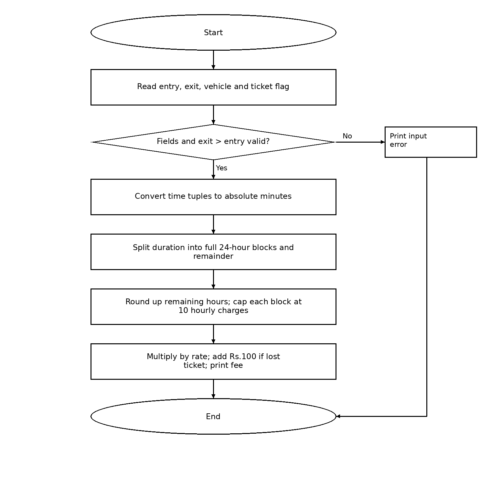
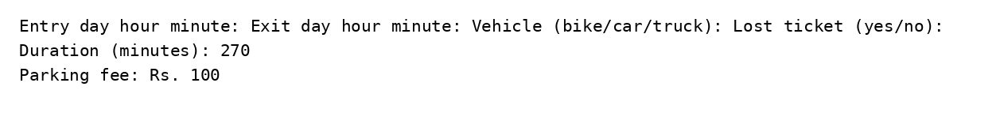

# Case 15: Smart Parking Fee Management

## Problem statement

Calculate parking charges using entry and exit times, vehicle category, overnight duration, daily caps and a lost-ticket penalty.

## Objectives

Validate time tuples and calculate started hours with integer arithmetic.

## Assumptions

Times are (day, hour, minute), with day >= 1, hour 0-23 and minute 0-59. Exit must be later than entry. Bike/car/truck rates are Rs.10/20/40 per started hour. Each elapsed 24-hour block costs at most 10 hourly charges; the remaining partial block has the same cap. Lost ticket adds Rs.100. Whole-number input only.

## Algorithm

1. Read entry, exit, category and lost-ticket flag.
2. Validate the time fields, category, flag and ordering.
3. Convert times to absolute minutes and split duration into 24-hour blocks and a remainder.
4. Round the remainder up to hours, apply caps and add the penalty.
5. Print the fee.

## Flowchart



## Pseudocode

```text
READ entry, exit, category, lost_ticket
VALIDATE all fields and exit > entry
IF invalid THEN PRINT error
ELSE
  duration = exit_minutes - entry_minutes
  full_days = duration DIV 1440
  remainder_hours = (duration MOD 1440 + 59) DIV 60
  fee = (full_days * 10 + MIN(remainder_hours, 10)) * rate
  IF lost_ticket = yes THEN fee = fee + 100
  PRINT fee
END IF
```

## Python source code

`solution.py`

```python
# Case 15: Smart Parking Fee Management
start = input('Entry day hour minute: ').split()
end = input('Exit day hour minute: ').split()
vehicle = input('Vehicle (bike/car/truck): ').strip().lower()
lost = input('Lost ticket (yes/no): ').strip().lower()
valid = len(start) == 3 and len(end) == 3
for value in start + end:
    if not value.isascii() or not value.isdigit():
        valid = False
rate = 0
for name, price in [('bike', 10), ('car', 20), ('truck', 40)]:
    if vehicle == name:
        rate = price
if rate == 0 or lost not in ('yes', 'no'):
    valid = False
if valid:
    entry = (int(start[0]), int(start[1]), int(start[2]))
    exit_time = (int(end[0]), int(end[1]), int(end[2]))
    for day, hour, minute in (entry, exit_time):
        if day < 1 or hour > 23 or minute > 59:
            valid = False
    day, hour, minute = entry
    a = (day - 1) * 1440 + hour * 60 + minute
    day, hour, minute = exit_time
    b = (day - 1) * 1440 + hour * 60 + minute
    if b <= a:
        valid = False
if not valid:
    print('Invalid parking data')
else:
    duration = b - a
    full_days = duration // 1440
    remainder = duration % 1440
    hours = min(10, (remainder + 59) // 60)
    fee = (full_days * 10 + hours) * rate
    if lost == 'yes':
        fee += 100
    print('Duration (minutes):', duration)
    print('Parking fee: Rs.', fee)
```

`demo_input.txt` (one line per prompt):

```text
1 22 0
2 2 30
car
no
```

## Test cases

1. **overnight**

Input:
```text
1 22 0
2 2 30
car
no
```
Expected output includes:
```text
Duration (minutes): 270
Parking fee: Rs. 100
```

2. **one minute**

Input:
```text
1 0 0
1 0 1
bike
no
```
Expected output includes:
```text
Parking fee: Rs. 10
```

3. **exact hour**

Input:
```text
1 0 0
1 1 0
car
no
```
Expected output includes:
```text
Parking fee: Rs. 20
```

4. **started next hour**

Input:
```text
1 0 0
1 1 1
car
no
```
Expected output includes:
```text
Parking fee: Rs. 40
```

5. **daily cap with penalty**

Input:
```text
1 0 0
2 0 0
car
yes
```
Expected output includes:
```text
Parking fee: Rs. 300
```

6. **two days plus minute**

Input:
```text
1 0 0
3 0 1
truck
no
```
Expected output includes:
```text
Parking fee: Rs. 840
```

7. **reverse interval**

Input:
```text
1 12 0
1 11 0
car
no
```
Expected output includes:
```text
Invalid parking data
```

8. **equal times**

Input:
```text
1 12 0
1 12 0
car
no
```
Expected output includes:
```text
Invalid parking data
```

9. **invalid hour**

Input:
```text
1 24 0
2 1 0
car
no
```
Expected output includes:
```text
Invalid parking data
```

10. **invalid category**

Input:
```text
1 0 0
1 1 0
bus
no
```
Expected output includes:
```text
Invalid parking data
```

11. **invalid ticket flag**

Input:
```text
1 0 0
1 1 0
car
maybe
```
Expected output includes:
```text
Invalid parking data
```

12. **nonnumeric time**

Input:
```text
x 0 0
2 1 0
car
no
```
Expected output includes:
```text
Invalid parking data
```

Run `python test_cases.py` from this folder, or use the root test runner.

`test_cases.py`

```python
# Standard-library checks; run with Python 3.
from pathlib import Path
import subprocess
import sys

solution = Path(__file__).with_name('solution.py')
tests = [('overnight',
  '1 22 0\n2 2 30\ncar\nno\n',
  ['Duration (minutes): 270', 'Parking fee: Rs. 100']),
 ('one minute', '1 0 0\n1 0 1\nbike\nno\n', ['Parking fee: Rs. 10']),
 ('exact hour', '1 0 0\n1 1 0\ncar\nno\n', ['Parking fee: Rs. 20']),
 ('started next hour', '1 0 0\n1 1 1\ncar\nno\n', ['Parking fee: Rs. 40']),
 ('daily cap with penalty',
  '1 0 0\n2 0 0\ncar\nyes\n',
  ['Parking fee: Rs. 300']),
 ('two days plus minute',
  '1 0 0\n3 0 1\ntruck\nno\n',
  ['Parking fee: Rs. 840']),
 ('reverse interval',
  '1 12 0\n1 11 0\ncar\nno\n',
  ['Invalid parking data']),
 ('equal times', '1 12 0\n1 12 0\ncar\nno\n', ['Invalid parking data']),
 ('invalid hour', '1 24 0\n2 1 0\ncar\nno\n', ['Invalid parking data']),
 ('invalid category', '1 0 0\n1 1 0\nbus\nno\n', ['Invalid parking data']),
 ('invalid ticket flag',
  '1 0 0\n1 1 0\ncar\nmaybe\n',
  ['Invalid parking data']),
 ('nonnumeric time', 'x 0 0\n2 1 0\ncar\nno\n', ['Invalid parking data'])]

for name, data, expected in tests:
    result = subprocess.run(
        [sys.executable, str(solution)], input=data,
        text=True, capture_output=True, timeout=5)
    if result.returncode != 0:
        raise AssertionError(name + ': program crashed\n' + result.stderr)
    for line in expected:
        if line not in result.stdout:
            raise AssertionError(name + ': missing ' + repr(line)
                                 + '\nActual output:\n' + result.stdout)
    print('PASS:', name)
print(str(len(tests)) + ' tests passed')
```

`test_results.txt`

```text
PASS: overnight
PASS: one minute
PASS: exact hour
PASS: started next hour
PASS: daily cap with penalty
PASS: two days plus minute
PASS: reverse interval
PASS: equal times
PASS: invalid hour
PASS: invalid category
PASS: invalid ticket flag
PASS: nonnumeric time
12 tests passed
```

## Output screenshots



Image rendered from the actual execution saved in `output.txt`:

```text
Entry day hour minute: Exit day hour minute: Vehicle (bike/car/truck): Lost ticket (yes/no): Duration (minutes): 270
Parking fee: Rs. 100
```

## Conclusion

Started-hour rounding and the cap are applied to elapsed 24-hour blocks, so overnight parking is handled correctly.
