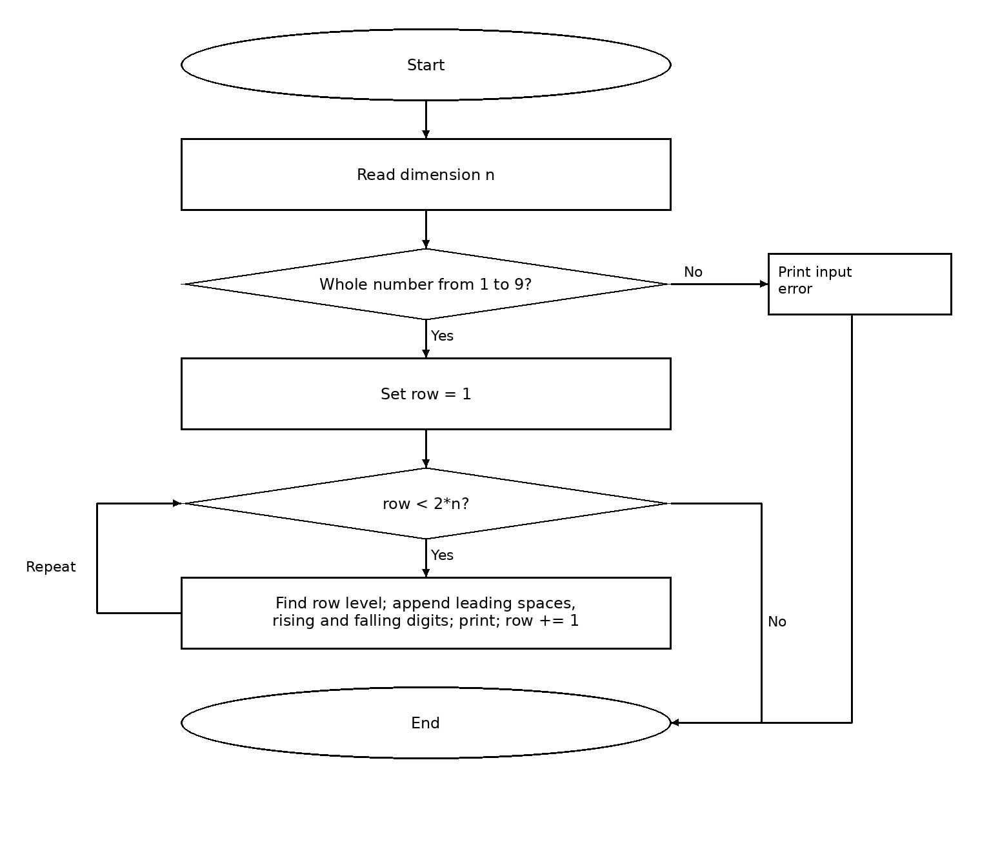
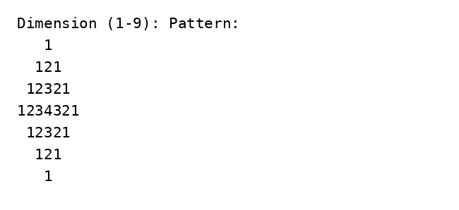

# Case 27: Advanced Numeric Pattern Generator

## Problem statement

Print a centred symmetric numerical diamond for a supplied dimension and reject invalid dimensions.

## Objectives

Use nested loops to generate an aligned numeric pattern.

## Assumptions

The dimension is an integer from 1 to 9, representing the number of rows up to the widest row. Each row rises from 1 to its row value and falls to 1. Single digits keep the spacing uniform. Total rows = 2 * dimension - 1.

## Algorithm

1. Validate the dimension.
2. Loop from the first row to row 2*n-1.
3. Calculate the row level and leading spaces.
4. Append increasing and decreasing digits and print the row.

## Flowchart



## Pseudocode

```text
READ n
IF n is not an integer from 1 to 9 THEN PRINT error
ELSE
  FOR row = 1 TO 2*n - 1
    level = row IF row <= n ELSE 2*n - row
    line = n - level spaces
    FOR digit = 1 TO level: append digit
    FOR digit = level - 1 DOWN TO 1: append digit
    PRINT line
END IF
```

## Python source code

`solution.py`

```python
# Case 27: Advanced Numeric Pattern Generator
text = input('Dimension (1-9): ').strip()
if not text.isascii() or not text.isdigit() or not 1 <= int(text) <= 9:
    print('Invalid dimension')
else:
    n = int(text)
    print('Pattern:')
    for row in range(1, 2 * n):
        if row <= n:
            level = row
        else:
            level = 2 * n - row
        line = ' ' * (n - level)
        for number in range(1, level + 1):
            line += str(number)
        for number in range(level - 1, 0, -1):
            line += str(number)
        print(line)
```

`demo_input.txt` (one line per prompt):

```text
4
```

## Test cases

1. **normal diamond**

Input:
```text
4
```
Expected output includes:
```text
Pattern:
   1
  121
 12321
1234321
 12321
  121
   1
```

2. **minimum dimension**

Input:
```text
1
```
Expected output includes:
```text
Pattern:
1
```

3. **maximum dimension**

Input:
```text
9
```
Expected output includes:
```text
12345678987654321
```

4. **zero**

Input:
```text
0
```
Expected output includes:
```text
Invalid dimension
```

5. **too large**

Input:
```text
10
```
Expected output includes:
```text
Invalid dimension
```

6. **negative**

Input:
```text
-2
```
Expected output includes:
```text
Invalid dimension
```

7. **decimal**

Input:
```text
2.5
```
Expected output includes:
```text
Invalid dimension
```

8. **letters**

Input:
```text
abc
```
Expected output includes:
```text
Invalid dimension
```

Run `python test_cases.py` from this folder, or use the root test runner.

`test_cases.py`

```python
# Standard-library checks; run with Python 3.
from pathlib import Path
import subprocess
import sys

solution = Path(__file__).with_name('solution.py')
tests = [('normal diamond',
  '4\n',
  ['Pattern:\n   1\n  121\n 12321\n1234321\n 12321\n  121\n   1\n']),
 ('minimum dimension', '1\n', ['Pattern:\n1\n']),
 ('maximum dimension', '9\n', ['12345678987654321']),
 ('zero', '0\n', ['Invalid dimension']),
 ('too large', '10\n', ['Invalid dimension']),
 ('negative', '-2\n', ['Invalid dimension']),
 ('decimal', '2.5\n', ['Invalid dimension']),
 ('letters', 'abc\n', ['Invalid dimension'])]

for name, data, expected in tests:
    result = subprocess.run(
        [sys.executable, str(solution)], input=data,
        text=True, capture_output=True, timeout=5)
    if result.returncode != 0:
        raise AssertionError(name + ': program crashed\n' + result.stderr)
    for line in expected:
        if line not in result.stdout:
            raise AssertionError(name + ': missing ' + repr(line)
                                 + '\nActual output:\n' + result.stdout)
    print('PASS:', name)
print(str(len(tests)) + ' tests passed')
```

`test_results.txt`

```text
PASS: normal diamond
PASS: minimum dimension
PASS: maximum dimension
PASS: zero
PASS: too large
PASS: negative
PASS: decimal
PASS: letters
8 tests passed
```

## Output screenshots



Image rendered from the actual execution saved in `output.txt`:

```text
Dimension (1-9): Pattern:
   1
  121
 12321
1234321
 12321
  121
   1
```

## Conclusion

The upper and lower halves use the same level rule, producing a centred and symmetric diamond.
