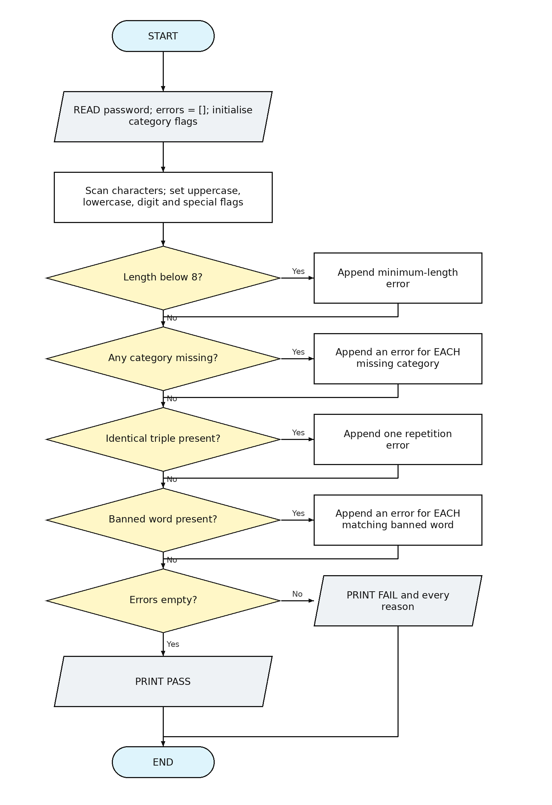
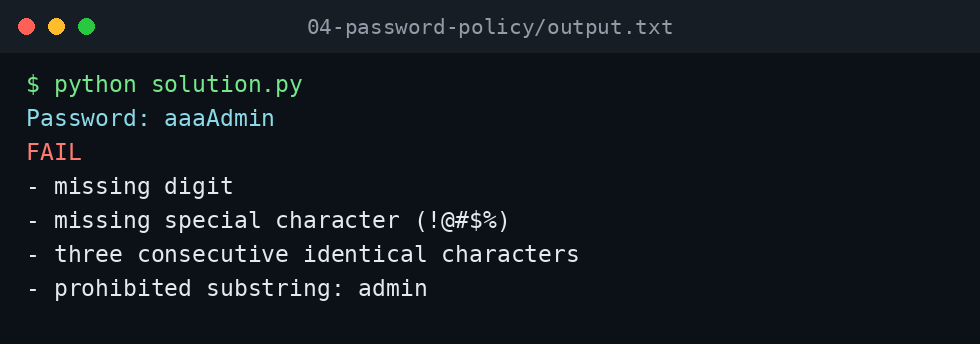

# Case 29: Password Policy Validation Engine

## Problem statement

Check a candidate password against length, character-category, repetition and prohibited-word rules, reporting every failure.

## Objectives

Scan strings using flags, lists and conditionals.

## Assumptions

At least 8 characters; include ASCII uppercase, lowercase, digit and one of !@#$%. Reject three identical consecutive characters and case-insensitive substrings password and admin. Other characters may appear but do not meet the required categories. This is a classroom policy, not production authentication.

## Algorithm

1. Read the password without removing spaces.
2. Scan characters for the four required categories.
3. Check length, adjacent triples and prohibited substrings.
4. Print PASS or every failed condition.

## Flowchart



## Pseudocode

```text
READ password
SET category flags to false and errors to empty list
SCAN characters and update flags
CHECK length and each missing category
SCAN adjacent triples; record repetition once
CHECK each prohibited substring ignoring case
IF errors is empty THEN PRINT PASS ELSE PRINT every error
```

## Python source code

`solution.py`

```python
# Case 29: Password Policy Validation Engine
password = input('Password: ')
upper = lower = digit = special = False
errors = []
for ch in password:
    if 'A' <= ch <= 'Z':
        upper = True
    elif 'a' <= ch <= 'z':
        lower = True
    elif '0' <= ch <= '9':
        digit = True
    elif ch in '!@#$%':
        special = True
if len(password) < 8:
    errors.append('minimum length is 8')
if not upper:
    errors.append('missing uppercase')
if not lower:
    errors.append('missing lowercase')
if not digit:
    errors.append('missing digit')
if not special:
    errors.append('missing special character (!@#$%)')
for i in range(len(password) - 2):
    if password[i] == password[i + 1] == password[i + 2]:
        errors.append('three consecutive identical characters')
        break
for word in ('password', 'admin'):
    if word in password.lower():
        errors.append('prohibited substring: ' + word)
if len(errors) == 0:
    print('PASS')
else:
    print('FAIL')
    for error in errors:
        print('-', error)
```

`demo_input.txt` (one line per prompt):

```text
aaaAdmin
```

## Test cases

1. **valid at minimum length**

Input:
```text
Abc123!x
```
Expected output includes:
```text
Password: PASS
```

2. **several failures**

Input:
```text
aaaAdmin
```
Expected output includes:
```text
FAIL
missing digit
missing special character
three consecutive identical characters
prohibited substring: admin
```

3. **short password**

Input:
```text
Short1!
```
Expected output includes:
```text
minimum length is 8
```

4. **empty password**

Input:
```text

```
Expected output includes:
```text
minimum length is 8
missing uppercase
missing lowercase
missing digit
missing special character
```

5. **case insensitive banned word**

Input:
```text
pAsSwOrD1!
```
Expected output includes:
```text
prohibited substring: password
```

6. **missing uppercase**

Input:
```text
abc123!x
```
Expected output includes:
```text
missing uppercase
```

7. **missing lowercase**

Input:
```text
ABC123!X
```
Expected output includes:
```text
missing lowercase
```

8. **unsupported special**

Input:
```text
Abc123?x
```
Expected output includes:
```text
missing special character
```

9. **two repeats allowed**

Input:
```text
Aabc11!x
```
Expected output includes:
```text
Password: PASS
```

10. **three repeats rejected**

Input:
```text
Abc111!x
```
Expected output includes:
```text
three consecutive identical characters
```

Run `python test_cases.py` from this folder, or use the root test runner.

`test_cases.py`

```python
# Standard-library checks; run with Python 3.
from pathlib import Path
import subprocess
import sys

solution = Path(__file__).with_name('solution.py')
tests = [('valid at minimum length', 'Abc123!x\n', ['Password: PASS\n']),
 ('several failures',
  'aaaAdmin\n',
  ['FAIL',
   'missing digit',
   'missing special character',
   'three consecutive identical characters',
   'prohibited substring: admin']),
 ('short password', 'Short1!\n', ['minimum length is 8']),
 ('empty password',
  '\n',
  ['minimum length is 8',
   'missing uppercase',
   'missing lowercase',
   'missing digit',
   'missing special character']),
 ('case insensitive banned word',
  'pAsSwOrD1!\n',
  ['prohibited substring: password']),
 ('missing uppercase', 'abc123!x\n', ['missing uppercase']),
 ('missing lowercase', 'ABC123!X\n', ['missing lowercase']),
 ('unsupported special', 'Abc123?x\n', ['missing special character']),
 ('two repeats allowed', 'Aabc11!x\n', ['Password: PASS\n']),
 ('three repeats rejected',
  'Abc111!x\n',
  ['three consecutive identical characters'])]

for name, data, expected in tests:
    result = subprocess.run(
        [sys.executable, str(solution)], input=data,
        text=True, capture_output=True, timeout=5)
    if result.returncode != 0:
        raise AssertionError(name + ': program crashed\n' + result.stderr)
    for line in expected:
        if line not in result.stdout:
            raise AssertionError(name + ': missing ' + repr(line)
                                 + '\nActual output:\n' + result.stdout)
    print('PASS:', name)
print(str(len(tests)) + ' tests passed')
```

`test_results.txt`

```text
PASS: valid at minimum length
PASS: several failures
PASS: short password
PASS: empty password
PASS: case insensitive banned word
PASS: missing uppercase
PASS: missing lowercase
PASS: unsupported special
PASS: two repeats allowed
PASS: three repeats rejected
10 tests passed
```

## Output screenshots



Terminal-style image rendered from the real interactive session in `output.txt` (including entered sample input):

```text
Password: aaaAdmin
FAIL
- missing digit
- missing special character (!@#$%)
- three consecutive identical characters
- prohibited substring: admin
```

## Conclusion

All violated rules are listed instead of stopping at the first failure.
