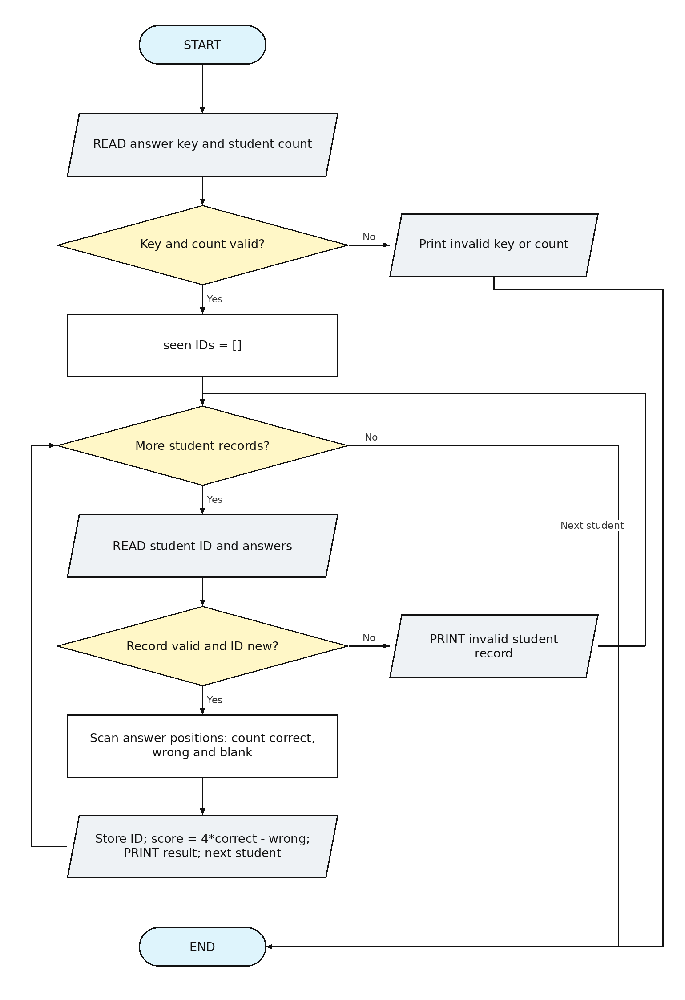
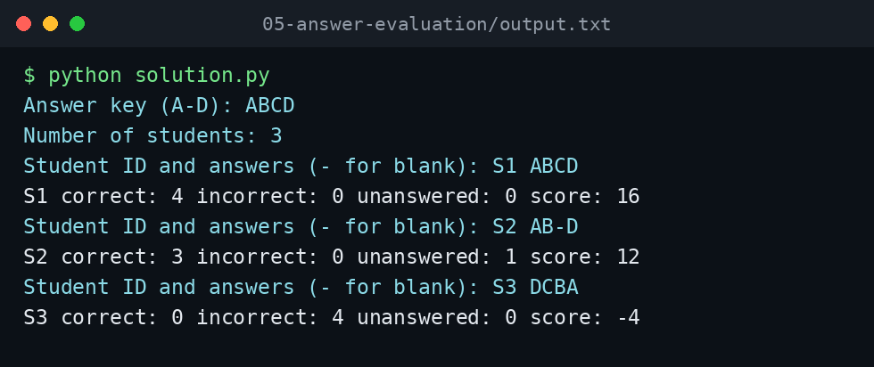

# Case 31: String-Based Examination Answer Evaluation

## Problem statement

Compare student answer strings with an answer key and calculate correct, incorrect and unanswered totals with negative marking.

## Objectives

Use string indexing, loops and tuple records to generate student-wise results.

## Assumptions

The key contains 1 to 50 letters A-D. Answers are case-insensitive A-D, with - meaning unanswered, and must match key length. Student identifiers are unique single words; 1 to 50 students are allowed. Correct = +4, incorrect = -1, unanswered = 0; negative totals are allowed.

## Algorithm

1. Validate the key and student count.
2. Read each student ID and answer string; validate length, characters and uniqueness.
3. For every valid answer string, compare each position with the key.
4. Count correct, incorrect and unanswered responses and print 4*correct-incorrect.

## Flowchart



## Pseudocode

```text
READ key and count
VALIDATE key and count
FOR each student
  READ id and answers
  IF invalid or duplicate THEN PRINT error
  ELSE
    FOR each question
      IF answer is dash THEN unanswered += 1
      ELSE IF answer equals key THEN correct += 1
      ELSE incorrect += 1
    PRINT counts and score = 4*correct - incorrect
```

## Python source code

`solution.py`

```python
# Case 31: String-Based Examination Answer Evaluation
key = input('Answer key (A-D): ').strip().upper()
text = input('Number of students: ').strip()
valid = 1 <= len(key) <= 50
for ch in key:
    if ch not in 'ABCD':
        valid = False
if not text.isascii() or not text.isdigit() or not 1 <= int(text) <= 50:
    valid = False
if not valid:
    print('Invalid key or student count')
else:
    seen = []
    for i in range(int(text)):
        row = input('Student ID and answers (- for blank): ').split()
        row_ok = len(row) == 2
        if row_ok:
            sid, answers = row[0], row[1].upper()
            if sid in seen or len(answers) != len(key):
                row_ok = False
            for ch in answers:
                if ch not in 'ABCD-':
                    row_ok = False
        if not row_ok:
            print('Invalid student record')
        else:
            seen.append(sid)
            correct = wrong = blank = 0
            for j in range(len(key)):
                if answers[j] == '-':
                    blank += 1
                elif answers[j] == key[j]:
                    correct += 1
                else:
                    wrong += 1
            result = (sid, correct, wrong, blank, 4 * correct - wrong)
            sid, correct, wrong, blank, score = result
            print(sid, 'correct:', correct, 'incorrect:', wrong,
                  'unanswered:', blank, 'score:', score)
```

`demo_input.txt` (one line per prompt):

```text
ABCD
3
S1 ABCD
S2 AB-D
S3 DCBA
```

## Test cases

1. **mixed students**

Input:
```text
ABCD
3
S1 ABCD
S2 AB-D
S3 DCBA
```
Expected output includes:
```text
S1 correct: 4 incorrect: 0 unanswered: 0 score: 16
S2 correct: 3 incorrect: 0 unanswered: 1 score: 12
S3 correct: 0 incorrect: 4 unanswered: 0 score: -4
```

2. **all blank**

Input:
```text
ABCD
1
S1 ----
```
Expected output includes:
```text
correct: 0 incorrect: 0 unanswered: 4 score: 0
```

3. **mixed score**

Input:
```text
ABCD
1
S1 AB-A
```
Expected output includes:
```text
correct: 2 incorrect: 1 unanswered: 1 score: 7
```

4. **lowercase allowed**

Input:
```text
abcd
1
S1 abcd
```
Expected output includes:
```text
score: 16
```

5. **invalid key**

Input:
```text
ABE
1
```
Expected output includes:
```text
Invalid key or student count
```

6. **wrong answer length**

Input:
```text
ABCD
1
S1 ABC
```
Expected output includes:
```text
Invalid student record
```

7. **bad answer character**

Input:
```text
ABCD
1
S1 ABCX
```
Expected output includes:
```text
Invalid student record
```

8. **duplicate ID**

Input:
```text
A
2
S1 A
S1 A
```
Expected output includes:
```text
S1 correct: 1 incorrect: 0 unanswered: 0 score: 4
Invalid student record
```

Run `python test_cases.py` from this folder, or use the root test runner.

`test_cases.py`

```python
# Standard-library checks; run with Python 3.
from pathlib import Path
import subprocess
import sys

solution = Path(__file__).with_name('solution.py')
tests = [('mixed students',
  'ABCD\n3\nS1 ABCD\nS2 AB-D\nS3 DCBA\n',
  ['S1 correct: 4 incorrect: 0 unanswered: 0 score: 16',
   'S2 correct: 3 incorrect: 0 unanswered: 1 score: 12',
   'S3 correct: 0 incorrect: 4 unanswered: 0 score: -4']),
 ('all blank',
  'ABCD\n1\nS1 ----\n',
  ['correct: 0 incorrect: 0 unanswered: 4 score: 0']),
 ('mixed score',
  'ABCD\n1\nS1 AB-A\n',
  ['correct: 2 incorrect: 1 unanswered: 1 score: 7']),
 ('lowercase allowed', 'abcd\n1\nS1 abcd\n', ['score: 16']),
 ('invalid key', 'ABE\n1\n', ['Invalid key or student count']),
 ('wrong answer length', 'ABCD\n1\nS1 ABC\n', ['Invalid student record']),
 ('bad answer character', 'ABCD\n1\nS1 ABCX\n', ['Invalid student record']),
 ('duplicate ID',
  'A\n2\nS1 A\nS1 A\n',
  ['S1 correct: 1 incorrect: 0 unanswered: 0 score: 4',
   'Invalid student record'])]

for name, data, expected in tests:
    result = subprocess.run(
        [sys.executable, str(solution)], input=data,
        text=True, capture_output=True, timeout=5)
    if result.returncode != 0:
        raise AssertionError(name + ': program crashed\n' + result.stderr)
    for line in expected:
        if line not in result.stdout:
            raise AssertionError(name + ': missing ' + repr(line)
                                 + '\nActual output:\n' + result.stdout)
    print('PASS:', name)
print(str(len(tests)) + ' tests passed')
```

`test_results.txt`

```text
PASS: mixed students
PASS: all blank
PASS: mixed score
PASS: lowercase allowed
PASS: invalid key
PASS: wrong answer length
PASS: bad answer character
PASS: duplicate ID
8 tests passed
```

## Output screenshots



Terminal-style image rendered from the real interactive session in `output.txt` (including entered sample input):

```text
Answer key (A-D): ABCD
Number of students: 3
Student ID and answers (- for blank): S1 ABCD
S1 correct: 4 incorrect: 0 unanswered: 0 score: 16
Student ID and answers (- for blank): S2 AB-D
S2 correct: 3 incorrect: 0 unanswered: 1 score: 12
Student ID and answers (- for blank): S3 DCBA
S3 correct: 0 incorrect: 4 unanswered: 0 score: -4
```

## Conclusion

Every question belongs to exactly one category, and the score includes negative marking.
