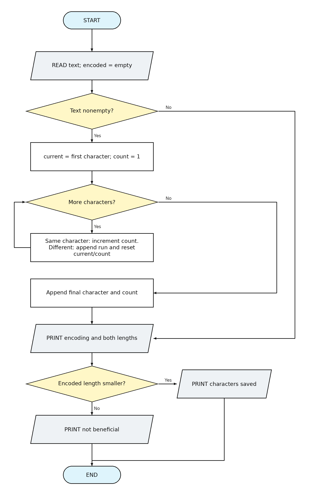
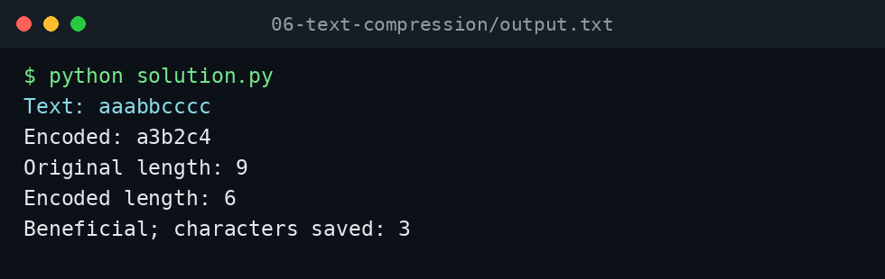

# Case 35: Text Compression Using Character Runs

## Problem statement

Encode consecutive runs of identical characters and compare the original and encoded lengths, including inputs that do not become shorter.

## Objectives

Use a loop and run counter to construct a string encoding.

## Assumptions

Input is one line of text, including spaces and digits; comparisons are case-sensitive. Every run uses character followed by count, including a count of 1. Empty text encodes to empty text. This is an encoding demonstration, not a reversible file format for arbitrary digit-containing text.

## Algorithm

1. Read a line without stripping spaces.
2. For nonempty text, keep the current character and count.
3. Extend matching runs; otherwise append the completed run and reset.
4. Append the final run and compare lengths.
5. Report whether the encoding is beneficial.

## Flowchart



## Pseudocode

```text
READ text
SET encoded to empty
IF text is not empty
  SET current = first character, count = 1
  FOR each remaining character
    IF same as current THEN increment count
    ELSE append current and count; reset run
  APPEND final current and count
PRINT encoded and both lengths
IF encoded is shorter THEN PRINT saving ELSE PRINT not beneficial
```

## Python source code

`solution.py`

```python
# Case 35: Text Compression Using Character Runs
text = input('Text: ')
encoded = ''
if len(text) > 0:
    current = text[0]
    count = 1
    for ch in text[1:]:
        if ch == current:
            count += 1
        else:
            encoded += current + str(count)
            current = ch
            count = 1
    encoded += current + str(count)
print('Encoded:', encoded)
print('Original length:', len(text))
print('Encoded length:', len(encoded))
if len(encoded) < len(text):
    print('Beneficial; characters saved:', len(text) - len(encoded))
else:
    print('Not beneficial')
```

`demo_input.txt` (one line per prompt):

```text
aaabbcccc
```

## Test cases

1. **compressible**

Input:
```text
aaabbcccc
```
Expected output includes:
```text
Encoded: a3b2c4
Original length: 9
Encoded length: 6
Beneficial; characters saved: 3
```

2. **all distinct**

Input:
```text
abc
```
Expected output includes:
```text
Encoded: a1b1c1
Encoded length: 6
Not beneficial
```

3. **empty text**

Input:
```text

```
Expected output includes:
```text
Encoded: 

Original length: 0
Encoded length: 0
Not beneficial
```

4. **one character**

Input:
```text
a
```
Expected output includes:
```text
Encoded: a1
Not beneficial
```

5. **equal lengths**

Input:
```text
aabb
```
Expected output includes:
```text
Encoded: a2b2
Original length: 4
Encoded length: 4
Not beneficial
```

6. **multi digit count**

Input:
```text
aaaaaaaaaaaa
```
Expected output includes:
```text
Encoded: a12
Beneficial; characters saved: 9
```

7. **spaces preserved**

Input:
```text
   
```
Expected output includes:
```text
Encoded:  3
Original length: 3
Encoded length: 2
```

8. **case sensitive**

Input:
```text
AaA
```
Expected output includes:
```text
Encoded: A1a1A1
```

9. **digit characters**

Input:
```text
11122
```
Expected output includes:
```text
Encoded: 1322
Original length: 5
Encoded length: 4
```

Run `python test_cases.py` from this folder, or use the root test runner.

`test_cases.py`

```python
# Standard-library checks; run with Python 3.
from pathlib import Path
import subprocess
import sys

solution = Path(__file__).with_name('solution.py')
tests = [('compressible',
  'aaabbcccc\n',
  ['Encoded: a3b2c4',
   'Original length: 9',
   'Encoded length: 6',
   'Beneficial; characters saved: 3']),
 ('all distinct',
  'abc\n',
  ['Encoded: a1b1c1', 'Encoded length: 6', 'Not beneficial']),
 ('empty text',
  '\n',
  ['Encoded: \n',
   'Original length: 0',
   'Encoded length: 0',
   'Not beneficial']),
 ('one character', 'a\n', ['Encoded: a1', 'Not beneficial']),
 ('equal lengths',
  'aabb\n',
  ['Encoded: a2b2',
   'Original length: 4',
   'Encoded length: 4',
   'Not beneficial']),
 ('multi digit count',
  'aaaaaaaaaaaa\n',
  ['Encoded: a12', 'Beneficial; characters saved: 9']),
 ('spaces preserved',
  '   \n',
  ['Encoded:  3', 'Original length: 3', 'Encoded length: 2']),
 ('case sensitive', 'AaA\n', ['Encoded: A1a1A1']),
 ('digit characters',
  '11122\n',
  ['Encoded: 1322', 'Original length: 5', 'Encoded length: 4'])]

for name, data, expected in tests:
    result = subprocess.run(
        [sys.executable, str(solution)], input=data,
        text=True, capture_output=True, timeout=5)
    if result.returncode != 0:
        raise AssertionError(name + ': program crashed\n' + result.stderr)
    for line in expected:
        if line not in result.stdout:
            raise AssertionError(name + ': missing ' + repr(line)
                                 + '\nActual output:\n' + result.stdout)
    print('PASS:', name)
print(str(len(tests)) + ' tests passed')
```

`test_results.txt`

```text
PASS: compressible
PASS: all distinct
PASS: empty text
PASS: one character
PASS: equal lengths
PASS: multi digit count
PASS: spaces preserved
PASS: case sensitive
PASS: digit characters
9 tests passed
```

## Output screenshots



Terminal-style image rendered from the real interactive session in `output.txt` (including entered sample input):

```text
Text: aaabbcccc
Encoded: a3b2c4
Original length: 9
Encoded length: 6
Beneficial; characters saved: 3
```

## Conclusion

Run encoding saves space for long repeated runs but can increase the size of ordinary text.
