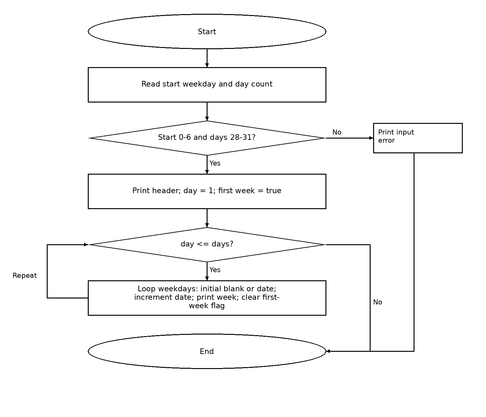
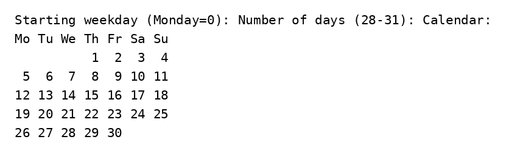

# Case 37: Nested Loop Calendar Generator

## Problem statement

Print a monthly calendar aligned to a supplied starting weekday and a valid number of days.

## Objectives

Use nested week and weekday loops with correct leading spaces.

## Assumptions

Monday is 0 and Sunday is 6. Valid month lengths are 28, 29, 30 and 31. No year or month is supplied, so the program validates only the supplied length, not leap years or month names.

## Algorithm

1. Validate starting weekday and month length.
2. Print the weekday header.
3. Repeat weeks until all dates are printed.
4. Within each week, print leading blank cells or the next date.
5. Remove trailing spaces and print the week.

## Flowchart



## Pseudocode

```text
READ start and days
IF invalid THEN PRINT error
ELSE
  PRINT weekday header
  SET day = 1, first_week = true
  WHILE day <= days
    SET line = empty
    FOR weekday = 0 TO 6
      IF first_week and weekday < start THEN append blank cell
      ELSE IF day <= days THEN append aligned date; increment day
    PRINT line without trailing spaces
    first_week = false
```

## Python source code

`solution.py`

```python
# Case 37: Nested Loop Calendar Generator
start_text = input('Starting weekday (Monday=0): ').strip()
days_text = input('Number of days (28-31): ').strip()
valid = True
for text in (start_text, days_text):
    if not text.isascii() or not text.isdigit():
        valid = False
if valid:
    start, days = int(start_text), int(days_text)
    if not 0 <= start <= 6 or days not in (28, 29, 30, 31):
        valid = False
if not valid:
    print('Invalid weekday or month length')
else:
    print('Calendar:')
    print('Mo Tu We Th Fr Sa Su')
    day = 1
    first_week = True
    while day <= days:
        line = ''
        for weekday in range(7):
            if first_week and weekday < start:
                line += '   '
            elif day <= days:
                line += str(day).rjust(2) + ' '
                day += 1
        print(line.rstrip())
        first_week = False
```

`demo_input.txt` (one line per prompt):

```text
3
30
```

## Test cases

1. **Thursday start**

Input:
```text
3
30
```
Expected output includes:
```text
Mo Tu We Th Fr Sa Su
          1  2  3  4

26 27 28 29 30
```

2. **Monday four full weeks**

Input:
```text
0
28
```
Expected output includes:
```text
 1  2  3  4  5  6  7

22 23 24 25 26 27 28
```

3. **Sunday start 31 days**

Input:
```text
6
31
```
Expected output includes:
```text
                   1

30 31
```

4. **29 days**

Input:
```text
0
29
```
Expected output includes:
```text
22 23 24 25 26 27 28
29
```

5. **weekday out of range**

Input:
```text
7
30
```
Expected output includes:
```text
Invalid weekday or month length
```

6. **invalid short month**

Input:
```text
0
27
```
Expected output includes:
```text
Invalid weekday or month length
```

7. **negative weekday**

Input:
```text
-1
30
```
Expected output includes:
```text
Invalid weekday or month length
```

8. **nonnumeric**

Input:
```text
Monday
30
```
Expected output includes:
```text
Invalid weekday or month length
```

Run `python test_cases.py` from this folder, or use the root test runner.

`test_cases.py`

```python
# Standard-library checks; run with Python 3.
from pathlib import Path
import subprocess
import sys

solution = Path(__file__).with_name('solution.py')
tests = [('Thursday start',
  '3\n30\n',
  ['Mo Tu We Th Fr Sa Su\n          1  2  3  4\n', '26 27 28 29 30\n']),
 ('Monday four full weeks',
  '0\n28\n',
  [' 1  2  3  4  5  6  7\n', '22 23 24 25 26 27 28\n']),
 ('Sunday start 31 days', '6\n31\n', ['                   1\n', '30 31\n']),
 ('29 days', '0\n29\n', ['22 23 24 25 26 27 28\n29\n']),
 ('weekday out of range', '7\n30\n', ['Invalid weekday or month length']),
 ('invalid short month', '0\n27\n', ['Invalid weekday or month length']),
 ('negative weekday', '-1\n30\n', ['Invalid weekday or month length']),
 ('nonnumeric', 'Monday\n30\n', ['Invalid weekday or month length'])]

for name, data, expected in tests:
    result = subprocess.run(
        [sys.executable, str(solution)], input=data,
        text=True, capture_output=True, timeout=5)
    if result.returncode != 0:
        raise AssertionError(name + ': program crashed\n' + result.stderr)
    for line in expected:
        if line not in result.stdout:
            raise AssertionError(name + ': missing ' + repr(line)
                                 + '\nActual output:\n' + result.stdout)
    print('PASS:', name)
print(str(len(tests)) + ' tests passed')
```

`test_results.txt`

```text
PASS: Thursday start
PASS: Monday four full weeks
PASS: Sunday start 31 days
PASS: 29 days
PASS: weekday out of range
PASS: invalid short month
PASS: negative weekday
PASS: nonnumeric
8 tests passed
```

## Output screenshots



Image rendered from the actual execution saved in `output.txt`:

```text
Starting weekday (Monday=0): Number of days (28-31): Calendar:
Mo Tu We Th Fr Sa Su
          1  2  3  4
 5  6  7  8  9 10 11
12 13 14 15 16 17 18
19 20 21 22 23 24 25
26 27 28 29 30
```

## Conclusion

The nested loops align both the first and last partial weeks without a calendar library.
