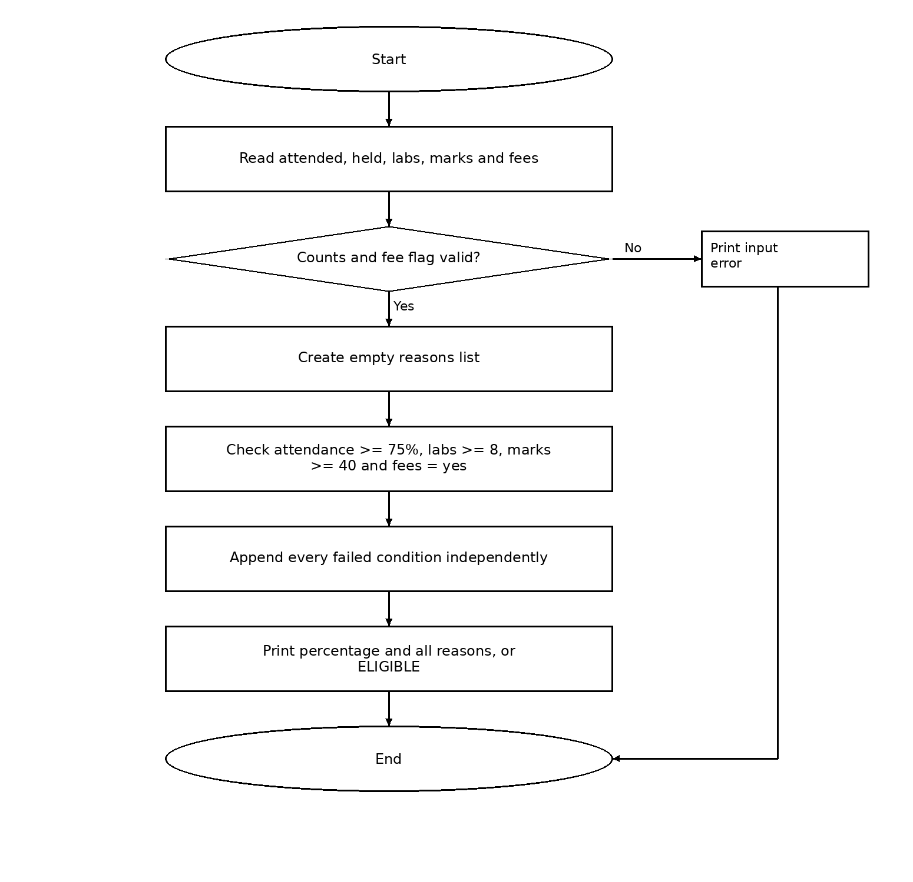
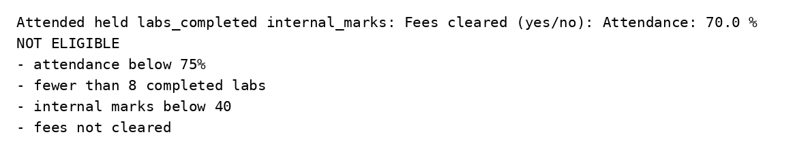

# Case 39: Multi-Stage Examination Eligibility System

## Problem statement

Check attendance, laboratory completion, internal marks and fee clearance to decide final-examination eligibility and report every unmet condition.

## Objectives

Combine multiple independent conditional checks and reason-wise reporting.

## Assumptions

Attendance is entered as attended and held classes, with held > 0 and 0 <= attended <= held. Eligibility requires attendance >= 75%, at least 8 completed labs out of 10, internal marks >= 40 out of 100 and fees marked yes. All counts and marks are integers.

## Algorithm

1. Read and validate attendance counts, lab count, internal marks and fee flag.
2. Calculate attendance percentage.
3. Independently check each of the four eligibility conditions.
4. Print ELIGIBLE if no reasons are stored; otherwise print every unmet condition.

## Flowchart



## Pseudocode

```text
READ attended, held, labs, marks, fees
IF input invalid THEN PRINT error
ELSE
  SET reasons = empty list
  IF attended*100 < 75*held THEN add attendance reason
  IF labs < 8 THEN add laboratory reason
  IF marks < 40 THEN add internal-marks reason
  IF fees is not yes THEN add fee reason
  PRINT percentage
  IF reasons empty THEN PRINT ELIGIBLE ELSE PRINT all reasons
```

## Python source code

`solution.py`

```python
# Case 39: Multi-Stage Examination Eligibility System
row = input('Attended held labs_completed internal_marks: ').split()
fees = input('Fees cleared (yes/no): ').strip().lower()
valid = len(row) == 4 and fees in ('yes', 'no')
for value in row:
    if not value.isascii() or not value.isdigit():
        valid = False
if valid:
    attended, held = int(row[0]), int(row[1])
    labs, marks = int(row[2]), int(row[3])
    if held == 0 or attended > held or labs > 10 or marks > 100:
        valid = False
if not valid:
    print('Invalid eligibility data')
else:
    reasons = []
    if attended * 100 < 75 * held:
        reasons.append('attendance below 75%')
    if labs < 8:
        reasons.append('fewer than 8 completed labs')
    if marks < 40:
        reasons.append('internal marks below 40')
    if fees != 'yes':
        reasons.append('fees not cleared')
    print('Attendance:', round(attended * 100 / held, 2), '%')
    if len(reasons) == 0:
        print('ELIGIBLE')
    else:
        print('NOT ELIGIBLE')
        for reason in reasons:
            print('-', reason)
```

`demo_input.txt` (one line per prompt):

```text
14 20 6 35
no
```

## Test cases

1. **exact thresholds**

Input:
```text
15 20 8 40
yes
```
Expected output includes:
```text
Attendance: 75.0 %
ELIGIBLE
```

2. **all conditions fail**

Input:
```text
14 20 6 35
no
```
Expected output includes:
```text
NOT ELIGIBLE
attendance below 75%
fewer than 8 completed labs
internal marks below 40
fees not cleared
```

3. **fully eligible**

Input:
```text
20 20 10 100
yes
```
Expected output includes:
```text
Attendance: 100.0 %
ELIGIBLE
```

4. **below attendance boundary**

Input:
```text
74 100 8 40
yes
```
Expected output includes:
```text
NOT ELIGIBLE
attendance below 75%
```

5. **zero held classes**

Input:
```text
0 0 8 40
yes
```
Expected output includes:
```text
Invalid eligibility data
```

6. **attended exceeds held**

Input:
```text
21 20 8 40
yes
```
Expected output includes:
```text
Invalid eligibility data
```

7. **invalid labs**

Input:
```text
15 20 11 40
yes
```
Expected output includes:
```text
Invalid eligibility data
```

8. **invalid fee flag**

Input:
```text
15 20 8 40
maybe
```
Expected output includes:
```text
Invalid eligibility data
```

9. **nonnumeric input**

Input:
```text
x 20 8 40
yes
```
Expected output includes:
```text
Invalid eligibility data
```

Run `python test_cases.py` from this folder, or use the root test runner.

`test_cases.py`

```python
# Standard-library checks; run with Python 3.
from pathlib import Path
import subprocess
import sys

solution = Path(__file__).with_name('solution.py')
tests = [('exact thresholds',
  '15 20 8 40\nyes\n',
  ['Attendance: 75.0 %\nELIGIBLE\n']),
 ('all conditions fail',
  '14 20 6 35\nno\n',
  ['NOT ELIGIBLE',
   'attendance below 75%',
   'fewer than 8 completed labs',
   'internal marks below 40',
   'fees not cleared']),
 ('fully eligible',
  '20 20 10 100\nyes\n',
  ['Attendance: 100.0 %\nELIGIBLE\n']),
 ('below attendance boundary',
  '74 100 8 40\nyes\n',
  ['NOT ELIGIBLE', 'attendance below 75%']),
 ('zero held classes', '0 0 8 40\nyes\n', ['Invalid eligibility data']),
 ('attended exceeds held',
  '21 20 8 40\nyes\n',
  ['Invalid eligibility data']),
 ('invalid labs', '15 20 11 40\nyes\n', ['Invalid eligibility data']),
 ('invalid fee flag', '15 20 8 40\nmaybe\n', ['Invalid eligibility data']),
 ('nonnumeric input', 'x 20 8 40\nyes\n', ['Invalid eligibility data'])]

for name, data, expected in tests:
    result = subprocess.run(
        [sys.executable, str(solution)], input=data,
        text=True, capture_output=True, timeout=5)
    if result.returncode != 0:
        raise AssertionError(name + ': program crashed\n' + result.stderr)
    for line in expected:
        if line not in result.stdout:
            raise AssertionError(name + ': missing ' + repr(line)
                                 + '\nActual output:\n' + result.stdout)
    print('PASS:', name)
print(str(len(tests)) + ' tests passed')
```

`test_results.txt`

```text
PASS: exact thresholds
PASS: all conditions fail
PASS: fully eligible
PASS: below attendance boundary
PASS: zero held classes
PASS: attended exceeds held
PASS: invalid labs
PASS: invalid fee flag
PASS: nonnumeric input
9 tests passed
```

## Output screenshots



Image rendered from the actual execution saved in `output.txt`:

```text
Attended held labs_completed internal_marks: Fees cleared (yes/no): Attendance: 70.0 %
NOT ELIGIBLE
- attendance below 75%
- fewer than 8 completed labs
- internal marks below 40
- fees not cleared
```

## Conclusion

Eligibility is based on all four conditions, and the report explains every unmet requirement.
