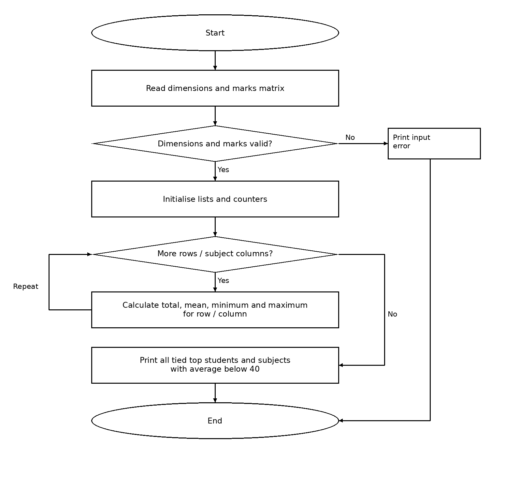
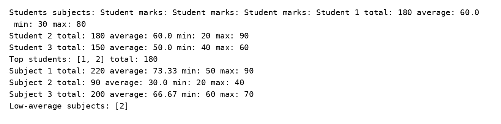

# Case 42: Student Marks Matrix Analysis

## Problem statement

Analyse student marks across subjects, calculate row and column statistics, identify top performers and flag subjects with low averages.

## Objectives

Use nested lists and loops to calculate totals, averages and extremes.

## Assumptions

There are 1 to 30 students and 1 to 10 subjects. Marks are integers from 0 to 100. Rows represent students and columns represent subjects, numbered from 1. A subject average strictly below 40 is low. All students tied for the highest total are top performers.

## Algorithm

1. Read and validate matrix dimensions and every mark.
2. For each student row, calculate total, average, minimum and maximum.
3. Find the highest total and print every tied student.
4. For each subject column, calculate total, average, minimum and maximum.
5. List subjects with average below 40.

## Flowchart



## Pseudocode

```text
READ rows, columns and mark matrix
IF dimensions or marks invalid THEN PRINT error
ELSE
  FOR each student row: calculate total, mean, min and max
  FIND highest total; PRINT all students with that total
  FOR each subject column
    calculate total, mean, min and max
    IF mean < 40 THEN add subject to low list
  PRINT low-subject list
```

## Python source code

`solution.py`

```python
# Case 42: Student Marks Matrix Analysis
size = input('Students subjects: ').split()
valid = len(size) == 2
for value in size:
    if not value.isascii() or not value.isdigit():
        valid = False
if valid:
    rows, columns = int(size[0]), int(size[1])
    if not 1 <= rows <= 30 or not 1 <= columns <= 10:
        valid = False
if not valid:
    print('Invalid matrix dimensions')
else:
    matrix = []
    for i in range(rows):
        data = input('Student marks: ').split()
        row_ok = len(data) == columns
        marks = []
        for value in data:
            if not value.isascii() or not value.isdigit():
                row_ok = False
            elif int(value) > 100:
                row_ok = False
            else:
                marks.append(int(value))
        if not row_ok:
            valid = False
        matrix.append(marks)
    if not valid:
        print('Invalid marks matrix')
    else:
        totals = []
        for i in range(rows):
            total = sum(matrix[i])
            totals.append(total)
            print('Student', i + 1, 'total:', total,
                  'average:', round(total / columns, 2),
                  'min:', min(matrix[i]), 'max:', max(matrix[i]))
        top = max(totals)
        toppers = []
        for i in range(rows):
            if totals[i] == top:
                toppers.append(i + 1)
        print('Top students:', toppers, 'total:', top)
        low = []
        for j in range(columns):
            subject = []
            for i in range(rows):
                subject.append(matrix[i][j])
            total = sum(subject)
            average = total / rows
            print('Subject', j + 1, 'total:', total,
                  'average:', round(average, 2),
                  'min:', min(subject), 'max:', max(subject))
            if total < 40 * rows:
                low.append(j + 1)
        print('Low-average subjects:', low)
```

`demo_input.txt` (one line per prompt):

```text
3 3
80 30 70
90 20 70
50 40 60
```

## Test cases

1. **matrix and tied toppers**

Input:
```text
3 3
80 30 70
90 20 70
50 40 60
```
Expected output includes:
```text
Student 1 total: 180 average: 60.0 min: 30 max: 80
Top students: [1, 2] total: 180
Subject 2 total: 90 average: 30.0 min: 20 max: 40
Low-average subjects: [2]
```

2. **single zero**

Input:
```text
1 1
0
```
Expected output includes:
```text
Student 1 total: 0 average: 0.0 min: 0 max: 0
Top students: [1] total: 0
Low-average subjects: [1]
```

3. **40 boundary not low**

Input:
```text
2 1
30
50
```
Expected output includes:
```text
Subject 1 total: 80 average: 40.0
Low-average subjects: []
```

4. **maximum mark**

Input:
```text
1 2
100 100
```
Expected output includes:
```text
total: 200 average: 100.0
Low-average subjects: []
```

5. **too high mark**

Input:
```text
1 1
101
```
Expected output includes:
```text
Invalid marks matrix
```

6. **negative mark**

Input:
```text
1 1
-1
```
Expected output includes:
```text
Invalid marks matrix
```

7. **ragged matrix**

Input:
```text
2 2
10 20
30
```
Expected output includes:
```text
Invalid marks matrix
```

8. **zero students**

Input:
```text
0 2
```
Expected output includes:
```text
Invalid matrix dimensions
```

9. **bad dimensions**

Input:
```text
x 2
```
Expected output includes:
```text
Invalid matrix dimensions
```

Run `python test_cases.py` from this folder, or use the root test runner.

`test_cases.py`

```python
# Standard-library checks; run with Python 3.
from pathlib import Path
import subprocess
import sys

solution = Path(__file__).with_name('solution.py')
tests = [('matrix and tied toppers',
  '3 3\n80 30 70\n90 20 70\n50 40 60\n',
  ['Student 1 total: 180 average: 60.0 min: 30 max: 80',
   'Top students: [1, 2] total: 180',
   'Subject 2 total: 90 average: 30.0 min: 20 max: 40',
   'Low-average subjects: [2]']),
 ('single zero',
  '1 1\n0\n',
  ['Student 1 total: 0 average: 0.0 min: 0 max: 0',
   'Top students: [1] total: 0',
   'Low-average subjects: [1]']),
 ('40 boundary not low',
  '2 1\n30\n50\n',
  ['Subject 1 total: 80 average: 40.0', 'Low-average subjects: []']),
 ('maximum mark',
  '1 2\n100 100\n',
  ['total: 200 average: 100.0', 'Low-average subjects: []']),
 ('too high mark', '1 1\n101\n', ['Invalid marks matrix']),
 ('negative mark', '1 1\n-1\n', ['Invalid marks matrix']),
 ('ragged matrix', '2 2\n10 20\n30\n', ['Invalid marks matrix']),
 ('zero students', '0 2\n', ['Invalid matrix dimensions']),
 ('bad dimensions', 'x 2\n', ['Invalid matrix dimensions'])]

for name, data, expected in tests:
    result = subprocess.run(
        [sys.executable, str(solution)], input=data,
        text=True, capture_output=True, timeout=5)
    if result.returncode != 0:
        raise AssertionError(name + ': program crashed\n' + result.stderr)
    for line in expected:
        if line not in result.stdout:
            raise AssertionError(name + ': missing ' + repr(line)
                                 + '\nActual output:\n' + result.stdout)
    print('PASS:', name)
print(str(len(tests)) + ' tests passed')
```

`test_results.txt`

```text
PASS: matrix and tied toppers
PASS: single zero
PASS: 40 boundary not low
PASS: maximum mark
PASS: too high mark
PASS: negative mark
PASS: ragged matrix
PASS: zero students
PASS: bad dimensions
9 tests passed
```

## Output screenshots



Image rendered from the actual execution saved in `output.txt`:

```text
Students subjects: Student marks: Student marks: Student marks: Student 1 total: 180 average: 60.0 min: 30 max: 80
Student 2 total: 180 average: 60.0 min: 20 max: 90
Student 3 total: 150 average: 50.0 min: 40 max: 60
Top students: [1, 2] total: 180
Subject 1 total: 220 average: 73.33 min: 50 max: 90
Subject 2 total: 90 average: 30.0 min: 20 max: 40
Subject 3 total: 200 average: 66.67 min: 60 max: 70
Low-average subjects: [2]
```

## Conclusion

Row and column reports give both student performance and subject-level weaknesses, while preserving all top-score ties.
