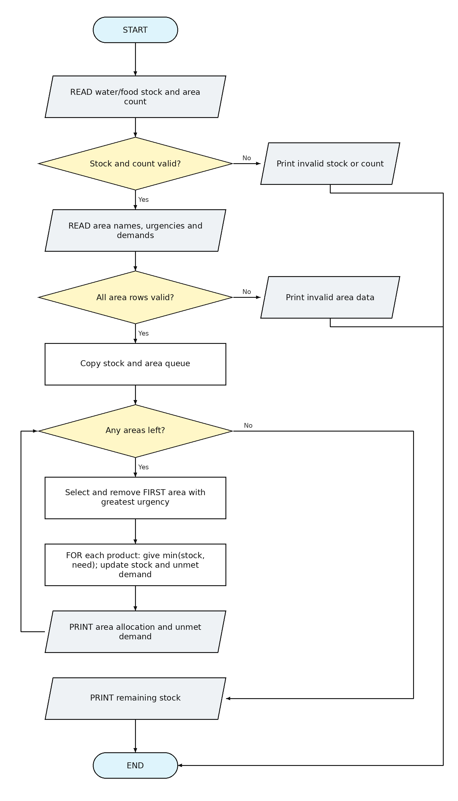
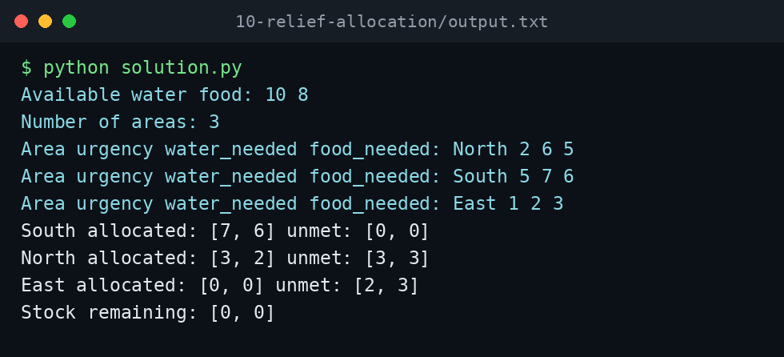

# Case 94: Disaster Relief Supply Allocation

## Problem statement

Allocate limited water and food supplies to areas by urgency, then report allocations, unmet demand and remaining stock.

## Objectives

Use nested lists, tuple unpacking and a stable priority-selection loop.

## Assumptions

The two products are water and food in that order. Stock, demand and urgency are whole nonnegative numbers. There are 1 to 50 uniquely named areas. Higher urgency is served first; input order resolves ties. Give each area as much as possible for each product before serving the next. This is an illustrative supplied allocation policy.

## Algorithm

1. Validate the two stock quantities, area count and each area row.
2. Copy stock and the area queue.
3. Repeatedly select the highest-urgency remaining area, preserving tie order.
4. Allocate min(remaining stock, requested amount) for each product.
5. Print allocation and unmet demand for each area and final stock.

## Flowchart



## Pseudocode

```text
READ stock and areas; VALIDATE all counts and unique names
IF invalid THEN PRINT error
ELSE
  COPY stock and area queue
  WHILE queue not empty
    FIND first area with greatest urgency
    REMOVE that area
    FOR each product
      give = MIN(stock, demand)
      stock = stock - give
      unmet = demand - give
    PRINT area, allocation and unmet
  PRINT remaining stock
```

## Python source code

`solution.py`

```python
# Case 94: Disaster Relief Supply Allocation
stock_text = input('Available water food: ').split()
count_text = input('Number of areas: ').strip()
valid = len(stock_text) == 2
for value in stock_text:
    if not value.isascii() or not value.isdigit():
        valid = False
if not count_text.isascii() or not count_text.isdigit():
    valid = False
elif not 1 <= int(count_text) <= 50:
    valid = False
if not valid:
    print('Invalid stock or area count')
else:
    stock = [int(stock_text[0]), int(stock_text[1])]
    areas = []
    names = []
    for i in range(int(count_text)):
        row = input('Area urgency water_needed food_needed: ').split()
        row_ok = len(row) == 4
        if row_ok:
            for value in row[1:]:
                if not value.isascii() or not value.isdigit():
                    row_ok = False
        if row_ok and row[0] in names:
            row_ok = False
        if not row_ok:
            valid = False
        else:
            names.append(row[0])
            areas.append((row[0], int(row[1]), [int(row[2]), int(row[3])]))
    if not valid:
        print('Invalid area data')
    else:
        remaining = stock[:]
        queue = areas[:]
        while len(queue) > 0:
            best = 0
            for i in range(1, len(queue)):
                if queue[i][1] > queue[best][1]:
                    best = i
            name, urgency, needs = queue.pop(best)
            given = []
            unmet = []
            for i in range(2):
                amount = min(remaining[i], needs[i])
                remaining[i] -= amount
                given.append(amount)
                unmet.append(needs[i] - amount)
            print(name, 'allocated:', given, 'unmet:', unmet)
        print('Stock remaining:', remaining)
```

`demo_input.txt` (one line per prompt):

```text
10 8
3
North 2 6 5
South 5 7 6
East 1 2 3
```

## Test cases

1. **priority and shortages**

Input:
```text
10 8
3
North 2 6 5
South 5 7 6
East 1 2 3
```
Expected output includes:
```text
South allocated: [7, 6] unmet: [0, 0]
North allocated: [3, 2] unmet: [3, 3]
East allocated: [0, 0] unmet: [2, 3]
Stock remaining: [0, 0]
```

2. **stable tie**

Input:
```text
5 5
2
First 2 4 4
Second 2 4 4
```
Expected output includes:
```text
First allocated: [4, 4] unmet: [0, 0]
Second allocated: [1, 1] unmet: [3, 3]
```

3. **zero stock**

Input:
```text
0 0
1
A 1 2 3
```
Expected output includes:
```text
A allocated: [0, 0] unmet: [2, 3]
Stock remaining: [0, 0]
```

4. **surplus stock**

Input:
```text
10 10
1
A 0 2 3
```
Expected output includes:
```text
Stock remaining: [8, 7]
```

5. **negative stock**

Input:
```text
-1 5
1
```
Expected output includes:
```text
Invalid stock or area count
```

6. **negative demand**

Input:
```text
5 5
1
A 2 -1 2
```
Expected output includes:
```text
Invalid area data
```

7. **duplicate names**

Input:
```text
5 5
2
A 1 2 2
A 2 2 2
```
Expected output includes:
```text
Invalid area data
```

8. **wrong demand shape**

Input:
```text
5 5
1
A 1 2
```
Expected output includes:
```text
Invalid area data
```

9. **invalid count**

Input:
```text
5 5
0
```
Expected output includes:
```text
Invalid stock or area count
```

Run `python test_cases.py` from this folder, or use the root test runner.

`test_cases.py`

```python
# Standard-library checks; run with Python 3.
from pathlib import Path
import subprocess
import sys

solution = Path(__file__).with_name('solution.py')
tests = [('priority and shortages',
  '10 8\n3\nNorth 2 6 5\nSouth 5 7 6\nEast 1 2 3\n',
  ['South allocated: [7, 6] unmet: [0, 0]\n'
   'North allocated: [3, 2] unmet: [3, 3]\n'
   'East allocated: [0, 0] unmet: [2, 3]\n'
   'Stock remaining: [0, 0]']),
 ('stable tie',
  '5 5\n2\nFirst 2 4 4\nSecond 2 4 4\n',
  ['First allocated: [4, 4] unmet: [0, 0]\n'
   'Second allocated: [1, 1] unmet: [3, 3]']),
 ('zero stock',
  '0 0\n1\nA 1 2 3\n',
  ['A allocated: [0, 0] unmet: [2, 3]', 'Stock remaining: [0, 0]']),
 ('surplus stock', '10 10\n1\nA 0 2 3\n', ['Stock remaining: [8, 7]']),
 ('negative stock', '-1 5\n1\n', ['Invalid stock or area count']),
 ('negative demand', '5 5\n1\nA 2 -1 2\n', ['Invalid area data']),
 ('duplicate names', '5 5\n2\nA 1 2 2\nA 2 2 2\n', ['Invalid area data']),
 ('wrong demand shape', '5 5\n1\nA 1 2\n', ['Invalid area data']),
 ('invalid count', '5 5\n0\n', ['Invalid stock or area count'])]

for name, data, expected in tests:
    result = subprocess.run(
        [sys.executable, str(solution)], input=data,
        text=True, capture_output=True, timeout=5)
    if result.returncode != 0:
        raise AssertionError(name + ': program crashed\n' + result.stderr)
    for line in expected:
        if line not in result.stdout:
            raise AssertionError(name + ': missing ' + repr(line)
                                 + '\nActual output:\n' + result.stdout)
    print('PASS:', name)
print(str(len(tests)) + ' tests passed')
```

`test_results.txt`

```text
PASS: priority and shortages
PASS: stable tie
PASS: zero stock
PASS: surplus stock
PASS: negative stock
PASS: negative demand
PASS: duplicate names
PASS: wrong demand shape
PASS: invalid count
9 tests passed
```

## Output screenshots



Terminal-style image rendered from the real interactive session in `output.txt` (including entered sample input):

```text
Available water food: 10 8
Number of areas: 3
Area urgency water_needed food_needed: North 2 6 5
Area urgency water_needed food_needed: South 5 7 6
Area urgency water_needed food_needed: East 1 2 3
South allocated: [7, 6] unmet: [0, 0]
North allocated: [3, 2] unmet: [3, 3]
East allocated: [0, 0] unmet: [2, 3]
Stock remaining: [0, 0]
```

## Conclusion

The priority policy does not allocate more than the available stock and makes every unmet requirement visible.
